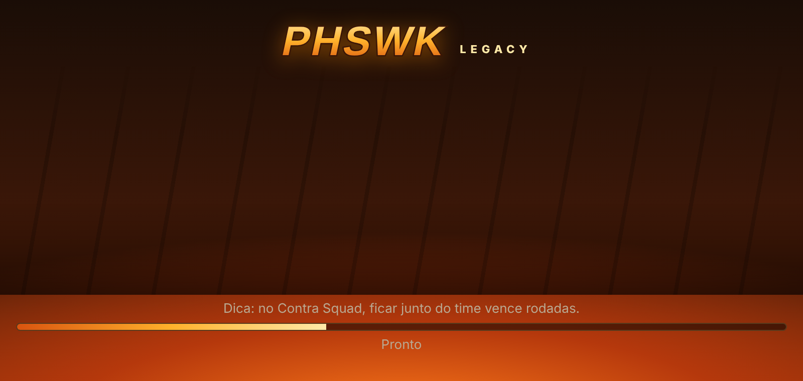

# PHSWK Legacy

Projeto **independente**, sem afiliação com Garena ou Free Fire. Tem servidor e cliente
próprios, além de conteúdo original: nenhum asset, protocolo ou chave do Free Fire foi usado.

## Estado atual (verificado)

- Servidor Node.js (`server/`):
  - contas de convidado salvas em arquivo;
  - 10.000 diamantes **virtuais** de demonstração;
  - loja e equipamento com itens próprios;
  - fila que completa com BOTs identificados;
  - Contra Squad 4x4 e Battle Royale simulados no servidor;
  - ranking próprio.
- Cliente web para o navegador do celular (`client/`), com PHSWK no topo da tela de carregamento.
- `npm test`: 15 testes passando (unidade + integração por HTTP/WebSocket).
- Fluxo completo testado no Chromium em tela de celular com toque: carregamento, login, compra, fila, partida com bots e resultado (capturas em `docs/capturas/`).
- **Ainda não verificado:** celular Android real e Termux.

Documentos: [INVENTARIO](docs/INVENTARIO.md) · [ARQUITETURA](docs/ARQUITETURA.md) · [COMPATIBILIDADE](docs/COMPATIBILIDADE.md) · [PLANO](docs/PLANO.md) · [REGISTRO](docs/REGISTRO.md)



## Rodar só pelo celular (Termux)

```sh
pkg install nodejs git
git clone <este repositório> && cd <repo>/phswk-legacy/server
npm install
npm test        # opcional
npm start       # abre em http://localhost:8080 no navegador do celular
```

Variáveis: `PORT` (8080), `DATA_FILE` (server/data/phswk.json) e `BOT_FILL_MS` (10000, que é a espera antes de completar a partida com bots).

## Limitações

- **Cliente oficial do Free Fire 2022** (provavelmente v1.70.x / OB32, jan/2022) **não é usado nem modificado**. Ligá-lo a outro servidor exigiria alterar e reassinar um APK proprietário e contornar as verificações de integridade dele.
- Login Google/Facebook: não implementado. Exige registrar um app próprio nesses provedores.
- Repositórios analisados:
  - `soneca7/FreeFireServer`: vazamento sem licença; usa uma chave extraída do cliente da Garena. Não foi reaproveitado.
  - `itsKyze/FreeFireServer`: 404.
  - `barbosaserver/BS`: só tem um README vazio.
